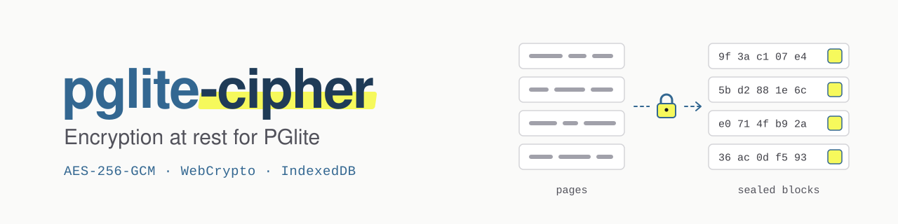

<picture>
  <source media="(prefers-color-scheme: dark)" srcset=".github/assets/banner-dark.svg">
  
</picture>

# pglite-cipher

Encryption at rest for [PGlite](https://pglite.dev), the Postgres build that runs in the browser. It works like SQLCipher, with AES-256-GCM through WebCrypto and no runtime dependencies.

- **Encrypts below Postgres.** Every file under PGDATA is encrypted, including catalogs, WAL and `pg_control`. File names, sizes and the file count are hidden.
- **Detects tampering.** A changed, moved, replayed or missing block fails the open (`CorruptStoreError`).
- **Two-tier keys.** You supply a key-encryption key, and the package wraps its own data key. You can change the key instantly, or rotate the data key.

**[Try the demo](https://2002bishwajeet.github.io/pglite-cipher/)**: in your own browser, compare plain and encrypted speed, search the raw storage for your data, and flip a bit to watch the open refuse it.

## Quick start

```sh
npm install pglite-cipher @electric-sql/pglite
```

Or straight from GitHub (it builds on install): `npm install github:2002Bishwajeet/pglite-cipher @electric-sql/pglite`.

```ts
import { PGlite } from '@electric-sql/pglite';
import { EncryptedFs, IndexedDbBackend, importKek } from 'pglite-cipher';

const key = await importKek(rawKey); // 32 random bytes, e.g. from the OS keychain
const fs = new EncryptedFs({ backend: new IndexedDbBackend('data'), key, mode: 'open-or-create' });
const pg = await PGlite.create({ fs, relaxedDurability: true });

await pg.exec('CREATE TABLE IF NOT EXISTS notes (id serial PRIMARY KEY, body text)');
await fs.syncToFs(false); // sync when it matters, e.g. when the page is hidden
await pg.close();
```

`@electric-sql/pglite` (`^0.5.10`) is a peer dependency. You can also use it from source as a git submodule ([Usage](docs/usage.md#use-from-another-repository-as-a-submodule)).

## What it does not protect

- **Memory.** While the database is open, it is plaintext in the page's memory.
- **A rollback of the whole store** to an older full copy. That copy opens.
- **Exports.** `dumpTar`, `dumpDataDir()` and `pg_dump` output are plaintext.

See [`SECURITY.md`](SECURITY.md) and the [threat model](docs/design/threat-model.md).

## Docs

- [Guides](docs/guides/README.md): quick start, adding it to an existing app, keys, rotation, errors
- [Usage](docs/usage.md): options, open modes, errors, keys and rotation, `verify()`, and memory on mobile
- [Design](docs/design/README.md): how it works, [performance](docs/design/performance.md) (including the known Android limit), and [comparisons](docs/design/comparison.md) with SQLCipher and others
- [`FORMAT.md`](FORMAT.md): the on-disk format, version 1
- [`bench/README.md`](bench/README.md): the benchmark
- [`llms.txt`](llms.txt) and [`llms-full.txt`](llms-full.txt): for coding agents that integrate it

## Develop

Requires Node 22 or newer. [`AGENTS.md`](AGENTS.md) has the rules.

```sh
npm ci
npx playwright install chromium firefox webkit   # add --with-deps on a fresh Linux machine
npm test                # Node
npm run test:browser    # Chromium, Firefox and WebKit
npm run lint && npm run typecheck
```

## Licence

[Apache-2.0](LICENSE), © Bishwajeet Parhi. Versions 0.1.0 and 0.1.1 were released under FSL-1.1-ALv2. Contributions are made under the [CLA](CLA.md). Third-party notices are in [`THIRD_PARTY.md`](THIRD_PARTY.md).
