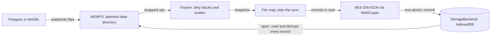
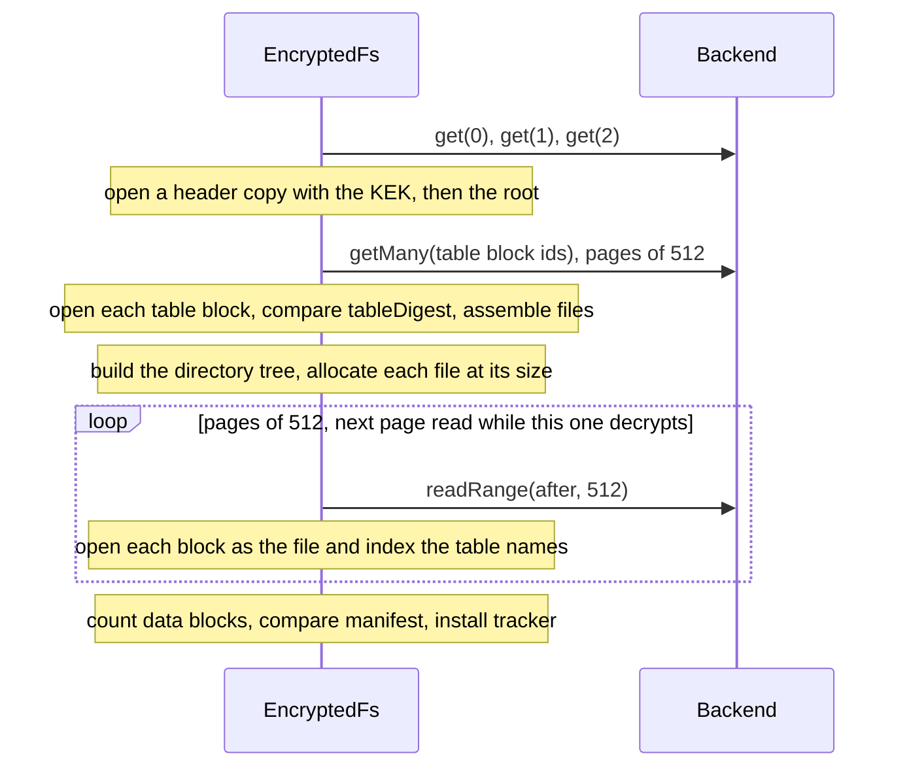
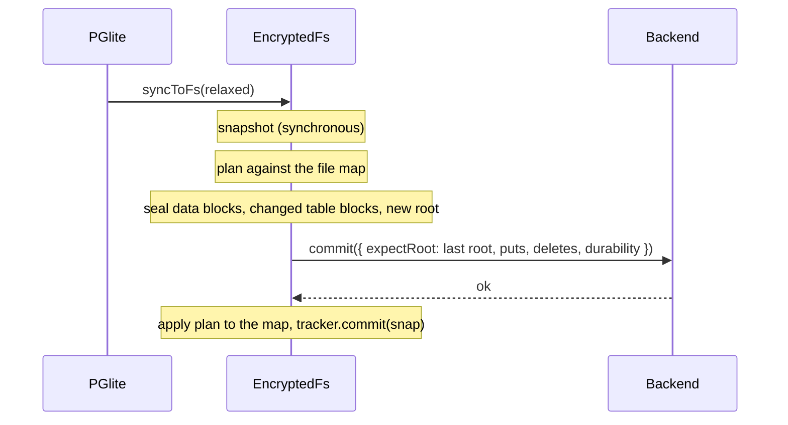

# Architecture and data flow

## Where the cipher sits

SQLCipher encrypts inside SQLite's pager, one page at a time. Postgres has no such hook, and its
pages have no spare bytes for a nonce and a tag. pglite-cipher therefore works one level lower, in
the filesystem that PGlite gives Postgres. Postgres reads and writes plain files and is not
changed. Every file under the data directory is covered: tables, indexes, WAL, `pg_control`, the
SLRUs, the catalogs and temp files.

`EncryptedFs` (`src/encryptedFs.ts`) extends PGlite's `MemoryFS`. PGlite calls four methods on it:

| PGlite calls | `EncryptedFs` does |
|---|---|
| `init` | runs the WebCrypto self-test (`src/format/selfTest.ts`), keeps a handle on Emscripten's `FS` |
| `initialSyncFs` | opens the store and loads it into MEMFS, or prepares a new store |
| `syncToFs(relaxed?)` | seals what changed and commits it in one batch |
| `closeFs` | waits for running work, commits what is left (strict), drops its memory, closes the backends |

## Why the database lives in memory

There were two places to put the cipher:

| | Encrypt on every read and write | MEMFS, encrypt changed blocks at sync |
|---|---|---|
| Crypto | Must be synchronous, so not WebCrypto; needs JavaScript or WASM AES | WebCrypto, asynchronous and hardware-backed |
| Storage | Must be synchronous: only OPFS sync access handles qualify, which are not reliable in every target webview | Any asynchronous store: IndexedDB, or a native store later |
| Memory | Small | The whole data directory, as with PGlite's own `idb://` |
| Atomicity across files | Needs its own journal | One storage transaction per sync |

pglite-cipher takes the second option. PGlite's `idb://` filesystem already keeps the whole data
directory in memory, so this adds no plaintext to memory that was not there before. The cost is at
open: every record is read and decrypted before Postgres starts (see
[performance.md](performance.md)). The gain is that a query never pays for cryptography.

## The tracker: knowing what changed

`src/tracker/tracker.ts` wraps the MEMFS operations that change a file under `/pglite/data`:

| Operation | Effect |
|---|---|
| `stream_ops.write` | marks the blocks written; a write past the end also marks the zero-filled hole from the old end |
| `stream_ops.msync` | marks the range (msync calls MEMFS's write directly, so the write wrapper does not see it) |
| `node_ops.setattr` | a size change (truncate, `posix_fallocate`) marks from the lower of the two sizes, and remembers the low point; a mode or time change marks the inode |
| `mknod`, `symlink` | a new node gets a random 16-byte file id |
| `rename` | marks the inode of the moved node and everything below it; no block is rewritten. A replaced node becomes dead |
| `unlink`, `rmdir` | the node becomes dead |

Per file it keeps a bitmap of dirty block indexes (`src/tracker/bitmap.ts`), whether the inode is
dirty, how many blocks the store holds, and the lowest size since the last sync. A file truncated
and extended again between two syncs is rewritten from that low point, so no stale block survives.

`snapshot()` is synchronous. Postgres runs to completion between two engine calls, so a snapshot
is a consistent cut even while a relaxed sync is still writing an earlier one. It copies each
dirty block, zero-padded to the block size, and lists changed inodes, cut block ranges and dead
files. After a successful commit the filesystem calls `commit(snap)`; after a failure,
`requeue(snap)` makes those changes dirty again.

**Safety net.** A missed write would leave the store without a block it should have, and the next
open would refuse the store. So each snapshot also walks the tree: a node no wrapper saw, or a file
whose size or mtime changed with nothing marked, is rewritten whole, and a node that disappeared
unseen is treated as removed. Each such case is counted in `stats().trackingGaps` and logged as a
count, never with a path.

## The file map: from files to records

The tracker speaks of files and block indexes. The store knows only random block ids. The file map
(`src/fs/fileMap.ts`) is the in-memory copy of the encrypted file table that joins them: per file,
its path, type, mode, size and the ordered ids of its blocks, and per id, the file and index.

A sync plans against the map as a `Draft`, which changes nothing until the commit is known to be in
the store:

- a dirty block of an existing index is put again **under the id it already has**;
- a new index gets a fresh random id;
- a changed path, type, mode, size or target changes that file's table entry, and only that table
  block is sealed again; a change to the modification time alone is ignored (the format stores
  none);
- cut indexes and dead files become deletes of their ids.

So a one-row `UPDATE` that grows no file writes data blocks and a root, and no table block.

Table entries stay in their table block while they fit, otherwise move to the first block with
room, otherwise to a new block. When the table has more than 4 blocks and less than half of their
bytes hold entries, the sync repacks the whole table densely under fresh ids, in the same commit
(`Draft.finish`). This moves no data block, and it is the only compaction in the format.

## Open

1. **Header and root.** The KEK opens a header copy (see [keys.md](keys.md)), and the header
   gives the data key and the store's parameters. The root names the file-table blocks.
2. **File table.** The listed table blocks are fetched by id and opened. Their tags must hash to
   the root's `tableDigest` before anything is built from them, so a replayed or reordered table
   never reaches MEMFS. `assembleFiles` (`src/format/table.ts`) then checks that the entries are
   consistent with each other and with the root.
3. **Blocks.** Every block is read in pages of 512 in id order (`PAGE` in `src/fs/pool.ts`), at most
   64 decrypts in flight. Each is opened with the file and index the table gives for its id, and
   copied into place. An id the table does not list fails the open. At the end the count of data
   blocks and the manifest digest must match the root.

Only then is the tracker installed. If anything fails, the partly built directory is removed, so
PGlite never finds a half-loaded data directory and never runs `initdb` over a store it could not
read. A load that fails while another writer commits starts over, up to 3 times
(`LOAD_ATTEMPTS`), then gives `StaleWriterError`.

**A new store** exists only in memory at first: a new data key and header (`createHeader`), an
empty map, and an empty MEMFS so that PGlite runs `initdb`. The first sync writes everything
initdb created, a densely packed table, the first root and both header copies, in one commit.

The open modes and the full error table are in `README.md`.

## Sync

- **One commit per sync.** Data blocks, table blocks, deletes and the new root go in one batch,
  so the file table is never newer or older than the blocks it describes.
- **Encryption happens before the commit,** outside any storage transaction.
- **`expectRoot`** is the root this instance last read or wrote. If the stored root is different,
  another writer has committed, and the commit rejects with `StaleWriterError` (see
  [integrity.md](integrity.md)).
- **Durability.** `syncToFs(false)` commits `strict`; anything else commits `relaxed`. A strict
  sync with nothing new to write, after a relaxed commit, puts the same root again in a strict
  commit, so that everything before it is durable.
- **Serialised.** Calls made during a sync wait for it and for one more run. Each caller's promise
  settles once everything dirty at its call is in the store. With `relaxedDurability`, PGlite does
  not await the sync, so a relaxed failure does not reject: the changes stay dirty and the next
  sync retries them.
- **The host can sync too.** PGlite does not always call `syncToFs` when it should (upstream
  issues electric-sql/pglite#1191, #1065, #1063). `hasDirty()` and `syncToFs(false)` let the host
  flush on its own, for example when the page is hidden.

## Close

`closeFs` waits for a running sync, key change, rotation or verify, then runs a strict sync if
anything is owed. Whether or not that sync succeeds, it then drops the module's `FS`, the tracker
and the file map, closes the backends and removes its reference to PGlite. A failed close-time
sync rejects with the backend's error; the store opens again at its last successful sync.

## Code map

| Path | Role |
|---|---|
| `src/encryptedFs.ts` | the filesystem: open, sync, close, key change, rotation |
| `src/tracker/` | dirty-block tracking over MEMFS |
| `src/fs/fileMap.ts` | the in-memory file table, sync planning, repacking |
| `src/fs/pool.ts` | page size (512) and WebCrypto concurrency (64) |
| `src/format/` | byte encodings, keys, sealing, digests, self-test, errors |
| `src/backend/` | the storage interface and its implementations |
| `src/verify.ts` | `verifyStore` and the record-by-record check |
