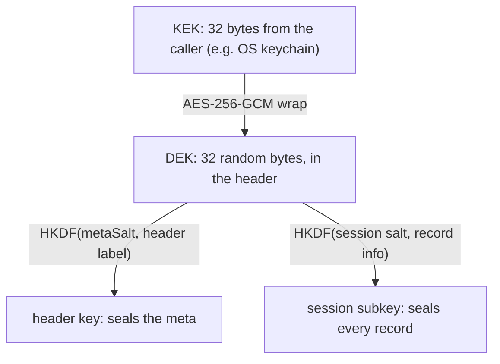

# Keys

## Two tiers

- **The KEK** (key-encryption key) is supplied by the caller. `importKek(raw)`
  (`src/format/keys.ts`) imports 32 raw bytes as a non-extractable AES-GCM key usable only for
  `wrapKey` and `unwrapKey`, and fills `raw` with zeros afterwards, also on failure. There is no
  passphrase KDF: the KEK must be random key material, such as a key from the OS keychain. A
  passphrase must not be passed in as a key.
- **The DEK** (data key) is 32 random bytes drawn once per store, and again at each data-key
  rotation. It is wrapped under the KEK in the header. Once imported it exists only as a
  non-extractable HKDF key: it never encrypts anything itself, it only feeds HKDF.
- **The header key** is derived from the DEK and the header's random `metaSalt`, and seals the
  header's meta (see [format.md](format.md)).
- **Session subkeys** seal every record.

Why two tiers: the KEK can change without touching the data, and the package can draw its own
data key without asking the caller for more than one key.

## Session subkeys

When a writer opens a store it draws one random 16-byte salt and derives one AES-256-GCM subkey,
`HKDF-SHA256(DEK, salt, "pglite-cipher/v1/record")`. Every record it writes carries that salt.
After `SUBKEY_MAX_ENCRYPTIONS = 2^24` encryptions it draws a new salt. A reader derives one subkey
per distinct salt it meets and caches it (`SubkeyCache` in `src/format/keys.ts`).

Why: with random 96-bit nonces, NIST SP 800-38D limits one AES-GCM key to about 2^32 encryptions.
With at most 2^24 uses per subkey, the chance of a nonce collision is about 2^-49 per subkey, and
the DEK has no lifetime limit. So nothing ever forces a rotation. SQLCipher 5 derives a one-time
subkey for every page write, after XAES-256-GCM; one derivation per session is what WebCrypto can
afford, since a derivation per record would add WebCrypto calls to every block. The cost is that
records written in one session share a visible salt (see [threat-model.md](threat-model.md)).

## Opening the header

`openHeader` tries copy 0, then copy 1. A copy *opens* when it is 168 bytes, its wrap unwraps
under the KEK, and its meta decrypts. The first copy that opens is used; if the other copy is
missing or differs, the next sync rewrites both. When neither opens:

| Situation | Result |
|---|---|
| a wrap unwrapped (the key is right) but the meta did not open | `CorruptStoreError` |
| the copies differ, or one is missing or the wrong length | `CorruptStoreError` |
| both present, identical, and neither unwraps | `WrongKeyError` |
| a copy opens and names a version or scheme this code does not know | `UnsupportedFormatError` |

There is no separate key-check value: the wrap's GCM tag is the key check. A WebCrypto error other
than a tag failure (a KEK without `unwrapKey`, say) is rethrown, so it can never read as a wrong
key.

Before any of this, `init` runs a known-answer test of HKDF-SHA256 then AES-256-GCM seal and open
(`src/format/selfTest.ts`). A platform whose WebCrypto computes a different answer gets
`CryptoSelfTestError` before it can write a store nobody can read.

## `changeKey(newKek)`: a new KEK

`rewrapHeader` unwraps the DEK under the old KEK, wraps it under the new one with a fresh nonce,
and seals the same meta again with a fresh salt and nonce (the meta is bound to the bytes of its
wrap). One strict commit, guarded by `expectRoot`, puts the new header in both slots. The root and
the blocks are not touched. Both copies change in one transaction, so the store is never under two
keys at once.

If that commit rejects, `changeKey` reads both header copies back:

| Read back | Result |
|---|---|
| the new key opens it | the change applied; `changeKey` resolves |
| only the old key opens it | `changeKey` rejects with the backend's error; the old key still works |
| the read fails, or neither opens it | `KeyChangeUnknownError`: keep both keys, retry or open with either |

**The limit.** Afterwards the old KEK does not open the store. But someone who kept a copy of the
old header and has the old KEK can unwrap the same DEK and read every later copy of the store.

## `rotateDataKey()`: a new DEK

A rotation draws a new DEK and seals every record again under it, into a **second, fresh store**,
then switches to it. It never re-encrypts in place, and it never builds one giant transaction. It
needs somewhere to write: the empty half of `IndexedDbBackend.pair(name)` (databases `<name>.a` and
`<name>.b`), or, with a single backend, `backendFactory()` plus `openOrigin` so an open can find the
store a crashed rotation was writing.

Steps, as in `#rotate` in `src/encryptedFs.ts`:

1. **Flush** with a strict sync. Syncs are held back from here on; queries keep running and the
   tracker keeps collecting their changes.
2. **Mark** the old store: a root with `state: rotating` and `origin` set to the new store's name.
   The name is inside the encrypted root; nothing readable links the two stores.
3. **Copy.** Write the new store's header (new DEK, `keyId + 1`, same KEK), then every data block
   read from MEMFS (not by decrypting the old store), each under a fresh random id, in commits of at
   most 512 records. No id of the old store is reused, so the two stores cannot be matched block for
   block. There is no root yet, so the new store reads as incomplete. Queries may change blocks
   during this copy.
4. **Catch up.** Take a tracker snapshot and apply it to the new store. Its data blocks now equal
   MEMFS at that instant. Then write the file table, once, densely packed.
5. **Read back** the new store (`checkBlocks` in `src/verify.ts`) and both header copies.
6. **Switch:** commit the new store's root, `state: ready`, with `expectRoot: null`. Until this
   commit, the old store is the store.
7. The filesystem moves to the new store, DEK and file map.
8. **Retire** the old store (a root still marked `rotating`, guarded by the mark) and delete it.

A failure before step 6 deletes the new store, sets the old one back to `ready`, and loses nothing:
MEMFS and the old store are intact. A crash at any step is resolved by the next open: if the new
store loads completely it is kept, otherwise the old store is set back to `ready` and loaded. The
state change on the old root is guarded by `expectRoot`, so if two instances try to resolve the same
rotation, only one wins and the other gets `StaleWriterError`. Writes made during a rotation become
durable when it completes. A rotation also leaves the file table densely packed.

**When to rotate.** Only when the KEK, or an old copy of the header, may have been exposed. A
rotation keeps the current KEK, so after a suspected exposure do both: `changeKey`, then
`rotateDataKey`.

## `verify()`

`fs.verify()`, or `verifyStore(backend, kek)` without Postgres (`src/verify.ts`), checks every
record, like SQLCipher's `PRAGMA cipher_integrity_check`:

1. both header copies, then the root;
2. the table blocks the root lists, their tags against `tableDigest`, and the table's consistency;
3. every block, in pages, each opened as the file and index the table names;
4. the data-block tags against `manifest`;
5. `count()` against the slots and blocks seen, so no record hides outside the pages.

It returns `{ ok, files, blocks, problems }`. Each problem is a record key (slot number or block id)
and one of the reasons `header-copy`, `root`, `table-block`, `table-digest`, `data-block`,
`missing`, `unlisted`, `manifest`. It never names a path. It does not throw for damage; it throws
only for a wrong key, an unsupported format, or a backend that fails. If the file table does not
verify, the data blocks cannot be attributed, and the check stops there. On an open filesystem,
syncs wait while it runs.
