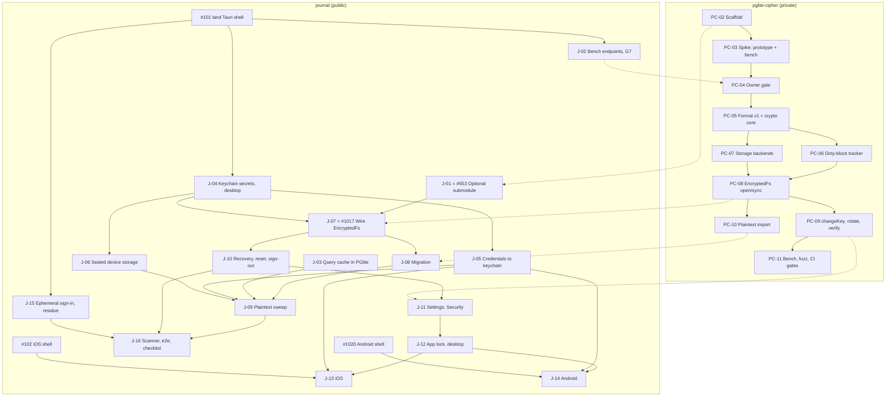

# Native data-at-rest security: overview

Plan only. Nothing here changes code or GitHub. Date: 2026-11-10. Planner model: Fable 5.2 (`claude-fable-5-2`).

**[unverified]** marks a claim I did not check against code or a primary source. Everything else was read in Journal at `main` (2.66.0), on `origin/feat/97-tauri-shell` (head `32580034`), in `node_modules/@electric-sql/pglite` 0.5.10, in the Tauri 2.12.5 crate source, in odin-core and odin-js checkouts, or in the cited page. Prior art is `docs/research/2026-11-10-prior-art.md`; I rely on its author's reading of the sources it marks "verified".

## 0. How the plan is laid out

Two repositories (owner decision 2026-11-10):

| Repository | Holds | Plan files | Placeholder |
|---|---|---|---|
| `2002Bishwajeet/pglite-cipher` (private) | The encrypted PGlite filesystem. **Premium features stay private.** | `docs/plan/02` … `11` | `#<PC-nn>` |
| `2002Bishwajeet/journal` (public) | The app. Consumes pglite-cipher as an **optional** git submodule; the PWA never imports it and builds identically without it | `docs/plan/journal/01` … `17` | `#<J-nn>` |

Other files: `01-sqlcipher-comparison.md` (parity table, performance, customer text), `99-owner-questions.md`, `gcmbench.mjs` (the Node micro-benchmark quoted in `01`).

Each issue file is a complete issue body in the Journal #1017 format, with a filing note in an HTML comment at the top (title, labels, what it replaces). `nn` in a placeholder is the file's number. When filing, replace every `#<PC-nn>` and `#<J-nn>` with the real number; `scripts/harness/select.mjs` rejects a line it cannot parse, so a missed placeholder fails closed. The `Depends on:` line takes same-repository numbers only. **Cross-repository dependencies are written in prose** in the issue's Context ("`2002Bishwajeet/pglite-cipher` must have … merged") and in the filing note, which also says when to add the `agent-ready` label.

Existing Journal issues: **#553 is rewritten** as the optional-submodule integration (`journal/01`); **#1017 is rewritten** as the wiring issue (`journal/07`); **#555** (epic) gets a new body (`journal/17`). #554 (browser encryption) is dropped and out of scope.

## 1. The claim we are building toward

> In the native apps, everything Journal stores on the device that comes from your notes, your people or your sign-in is encrypted with a key that the operating system's keychain holds. A copy of the app's data folder, a backup of it, or the disk of a powered-off device does not reveal it.

That sentence is only true when **every** row of the gap table in section 4 is closed. The earlier spec covered one row (the database).

## 2. Threat model

### 2.1 Attackers

| # | Attacker | In scope? |
|---|---|---|
| A1 | Has a **copy of the app's data folder**: a backup (Time Machine, File History, iCloud, Google Auto Backup, a synced home folder), a disk image, a support bundle | **Yes. This is the main case.** |
| A2 | Has the **powered-off device** and the OS disk encryption is off or broken | Yes, as far as the OS keychain itself resists it (2.2) |
| A3 | **Another OS account** on the same machine, without admin rights | Yes |
| A4 | Someone at the **unlocked device** for a short time | Only with the app lock on (`journal/12`, `13`, `14`) |
| A5 | **Another app running as the same user** (not malware with exploits: a curious or badly behaved app) | Depends on the platform (2.2). Stated honestly, not claimed everywhere |
| A6 | Changes files in the data folder to make the app **accept altered data** | Detected inside one store; a rollback of the whole store to an older copy is not (accepted, see `01`) |
| A7 | **Code running as the user while Journal is unlocked** (malware, a debugger), or as admin/root | **No.** No design at this layer stops it: it can read the worker's memory or ask the keychain |
| A8 | **Script injection inside the app** (XSS in the main frame) | **No** for at-rest purposes: injected script can query the database directly. The app's CSP is Report-Only and must allow inline script for live blocks, so it is not a defence here. The plan limits what injected script can take away (keys are non-extractable, commands check their caller, live-block frames are proven to have no IPC) but claims nothing |
| A9 | Homebase server compromise, network attackers | Out of scope: that is Homebase's end-to-end encryption |

### 2.2 What the key storage gives, per platform

The database key, the Homebase credentials and the device-storage key live in the OS keychain. The protection is the keychain's, not ours, and it differs:

| | macOS | Windows | Linux | iOS | Android |
|---|---|---|---|---|---|
| Store | Login keychain | Credential Manager (DPAPI) | Secret Service (GNOME Keyring, KWallet). Never the kernel keyutils store (lost at reboot), never a file | Keychain, hardware class keys | Keystore (TEE or StrongBox) key that wraps the secrets |
| A1 backup or folder copy | Protected. The login keychain is in Time Machine too, but encrypted with the login password | Protected. DPAPI blobs need the user's password | Protected if the keyring has a password. **An auto-login keyring with an empty password protects nothing** | Protected. Items are `ThisDeviceOnly`: never in a backup | Protected. Keystore keys never leave the device; Auto Backup is turned off |
| A2 powered-off device | As strong as the login password | As strong as the login password | As strong as the keyring password | Hardware-bound, strong | Hardware-bound, strong |
| A3 other account | Protected | Protected | Protected | n/a | n/a (profiles are separate) |
| A5 same-user app | **Protected for signed builds**: the keychain ACL is tied to the code signature. Unsigned dev builds are not | **Not protected**: any process of the user can read the credential (the same limit Electron documents for `safeStorage`) | **Not protected**: any process on the session bus can read an unlocked collection | Already stopped by the sandbox | Already stopped by the sandbox |
| What encryption adds over the OS alone | Backups, other accounts, other apps, FileVault off | Backups, other accounts, BitLocker off | Backups, other accounts, LUKS off | Backups and device transfer, forensic images | Auto Backup and device transfer, forensic and rooted copies |
| Biometric app lock | Touch ID, app-level gate (an OS-enforced binding is owner question 7) | Windows Hello, app-level gate | None | Face ID / Touch ID | BiometricPrompt |

The macOS column depends on signed builds (#305). The Linux empty-password case and the Windows same-user case go into the in-app text (`journal/11`) and the customer text in `01`.

### 2.3 Not protected, in any design here

- Data in memory while unlocked: the whole database is plaintext in the worker's RAM (as SQLCipher's page cache is), and can reach swap or a hibernation file. Relies on the OS encrypting swap.
- Whole-store rollback to an older valid copy.
- What the user exports, prints, copies to the clipboard, or mirrors to a folder (#1015).
- What the OS learns on its own: keyboard learning, notification history, screen recordings.

## 3. Architecture summary

```
 Rust (journal/src-tauri)              Webview page (http://localhost:47821)            DB worker
 ┌──────────────────────┐  invoke     ┌─────────────────────────────────────┐ init opts ┌──────────────────────────────┐
 │ secrets.rs           │────────────▶│ nativeSecrets.ts: raw key bytes →   │──────────▶│ EncryptedFs (pglite-cipher,   │
 │  OS keychain:        │  raw bytes  │  non-extractable CryptoKey (KEK),   │ CryptoKey │  private submodule)           │
 │   db-kek             │             │  buffer zeroed                      │           │  MEMFS + dirty-block tracker  │
 │   credentials        │             │ credentialStore.ts (token, secret)  │           │  AES-256-GCM, session subkeys │
 │   storage-key        │             │ storage.ts: sealed localStorage     │           │  one IndexedDB txn per sync   │
 │ caller checks, lock  │             │ query cache → PGlite table          │           │  Postgres (PGlite) on top     │
 │ auth_window.rs       │             │ sign-in in an ephemeral window      │           └──────────────────────────────┘
 └──────────────────────┘             └─────────────────────────────────────┘
```

- **Database** (decisions 1, 2): `pglite-cipher`, a PGlite `Filesystem` that keeps Postgres in MEMFS, tracks dirty blocks (8 KB unless the spike says otherwise), and writes each as an AES-256-GCM record to IndexedDB in one transaction per sync. The keychain key (KEK) wraps a data key (DEK) kept in a duplicated header. The DEK never encrypts data itself: **each session derives a subkey from it with HKDF**, which is how the format gets what SQLCipher 5 gets from per-write subkeys (no key near the 2^32 random-nonce limit, no forced rotation) at one extra WebCrypto call per session. **Two digests** over every record's GCM tag, in the encrypted root record, detect deleted, replayed or spliced records. Details: `05-format-v1-crypto-core.md`.
- **What the store shows** (owner decisions of 2026-11-10, after the first draft; they remove the two "weaker" rows of `01` that were about the stored bytes):
  - **Opaque header.** The header is 168 bytes in which only random nonces and salts are readable. Version, cipher, block size, store id and key id are inside an AEAD envelope under a key derived from the DEK; a reader learns the version by opening it. No magic and no name in clear anywhere, and the IndexedDB database gets a neutral name from the app (`data.a`, `data.b` in Journal).
  - **Packed block space.** The store is one flat space of equal-size encrypted blocks under random ids. An encrypted **file table**, itself stored in some of those blocks, maps each path to its file id, size, mode and the ordered ids of its blocks. A block keeps its id for as long as it exists and is rewritten in place, so a commit that only changes contents writes no file-table block; data, file table and root go into the same transaction.
  - Someone with the files sees that an IndexedDB database exists, how many blocks it holds, and when they are written. Not how many files there are, how big any of them is, or which block belongs to which.
- **Where the store lives** is decided at the owner gate (`04`), before any package code, from measured IPC throughput (gate G7): IndexedDB with our format (the default this plan is written for), a Rust-managed file of our ciphertext, or a SQLCipher database in Rust. Owner question 2.
- **Key** (decision 3): 32 random bytes made in Rust, stored in the keychain, returned to the page as raw bytes once per launch, imported with `wrapKey`/`unwrapKey` usages only. A keychain that is temporarily unavailable never leads to a new key (the lesson of Element's lost sessions).
- **Credentials** (decision 3): behind `credentialStore`; native keeps them in the keychain and in memory, never in `localStorage`.
- **Query cache** (decision 4): one row per query in a `query_cache` table inside PGlite. Public code; ships for the PWA too.
- **Small device state** that holds note content or titles (unsaved-edit copies, open tabs, recents): sealed in `localStorage` with a third keychain key.
- **Sign-in**: on desktop the owner console runs in an ephemeral window, so its 6-month cookie and its own shared secret never reach the app's data folder; on mobile they are removed after sign-in.
- **Optional submodule**: one build flag, `VITE_NATIVE_ENCRYPTION`. Off: the alias resolves to a stub and the bundler drops the code; a script proves the PWA build is byte-identical with and without the submodule. On: native builds, which need the submodule; only the native CI workflow has the deploy key.

## 4. Gap analysis: everything at rest in the native app

"Earlier" = how the first spec and the old #1017 treated it. Issue numbers are plan files: `PC-nn` in this folder, `J-nn` in `journal/`.

| # | Data | Where it is today (verified) | Earlier | Decision | Issue |
|---|---|---|---|---|---|
| 1 | PGlite data dir: notes (`document_updates`), search index, version snapshots, pending image blobs, sync records, `app_state`, the diagnostics log | IndexedDB `/pglite/journal-db-pg18`, whole files in plaintext (`src/lib/db/pglite-worker.ts`) | Covered | **In scope.** Encrypted filesystem | PC-05–11, J-01, J-07 |
| 2 | **Homebase auth token and shared secret** | `localStorage` `BX0900`, `APSS` (`src/hooks/auth/useYouAuthAuthorization.ts:149-150`, read in `src/hooks/auth/useAuth.ts:23,37,41`) | "Follow-up" | **In scope, release blocker** (review B1). Keychain | J-04, J-05 |
| 3 | **Owner-console session for the whole identity** | Sign-in navigates the app's own webview to `https://<identity>/api/owner/v1/youauth/authorize` (`src/pages/Landing.tsx:59`). odin-core sets the owner cookie with `Expires = now + 6 months` (`Odin.Hosting/Authentication/YouAuth/AuthenticationCookieUtil.cs`, called from `OwnerAuthenticationController.cs:79`), and the owner console stores `OWNER_SHARED_SECRET` in that origin's `localStorage` (odin-js `packages/apps/owner-app/src/hooks/auth/useAuth.ts:136`). Both stay in the app's webview profile | **Missed** | **In scope, release blocker.** Stronger than gap 2: owner-level access to the identity, not the app's drive grant. Desktop: ephemeral sign-in window and a navigation guard. Mobile: remove that origin's cookies and site data after sign-in | J-15, J-13, J-14 |
| 4 | **Unsaved-edit copies of note content** | `localStorage` `journal-unsaved-edits:<docId>`, a base64 Yjs update written on page hide (`src/lib/yjs/unsavedEdits.ts`) | **Missed** | **In scope.** Sealed device storage | J-06 |
| 5 | Open tabs (note titles), recent notes (titles), recent searches (query text), last note and folder | `localStorage` `journal-open-tabs`, `journal-recent-notes`, `journal-recent-searches`, `journal-session-state` (`src/lib/storage.ts`) | **Missed** | **In scope.** Sealed device storage | J-06 |
| 6 | React Query cache: contacts, connections, circles and members, security context, link metadata, version-history lists, image query data | IndexedDB `keyval-store`, key `journal-query-cache`, 7 days, no filter (`src/App.tsx:51-66`). It also survives sign-out today | "Follow-up" | **In scope** (decision 4). Table in PGlite; old database deleted; cleared at sign-out | J-03, J-09 |
| 7 | Service worker caches of note-derived images | Cache Storage `proxied-images` (every external image a note shows, keyed by its URL), `images`, and Workbox's URL list for it (`src/sw.ts`) | Review only | **In scope.** Native does not persist them and fetches with `cache: 'no-store'`; existing ones are deleted. Cost: hot-linked images need the network (owner question 9) | J-09 |
| 8 | `api-cache` | Cache Storage, same-origin `/api/` only. The native origin has no `/api/` | – | Delete in native | J-09 |
| 9 | Other `localStorage`: theme, editor appearance, sidebar state, AI settings, feature notices, PGlite version stamps, `identity` (the Homebase domain, written by js-lib) | `localStorage` | – | **Out of scope**: no note content and no secret. `identity` shows which Homebase the device uses; accepted. A guard test forces every new key to be classified. **Constraint:** #1034 (bring-your-own API keys) must use `writeSealed()` | J-06 |
| 10 | ECC key pair used once during sign-in | js-lib `saveEccKey` (IndexedDB `blob-storage`), removed at finalize | – | Out of scope: single use, useless after the exchange | – |
| 11 | `sessionStorage` (tab stacks, reload guard) | Session only; route paths (ids) | – | Out of scope | – |
| 12 | Webview HTTP disk cache | Managed by the webview. App assets are public. Homebase app-API responses are encrypted with the shared secret **[unverified for every endpoint]** | **Missed** | **Verify, then decide.** The checklist scans the cache folder on real installs; a hit files the follow-up named in J-16 | J-16 |
| 13 | Legacy Postgres 17 database | IndexedDB `/pglite/journal-db`, `journal-db` | – | Native never ran those engines. Delete if present | J-09 |
| 14 | Plaintext leftovers of the old stores after migration | IndexedDB engine pages, free disk blocks | A question | **Delete; cannot guarantee erasure** (decision 5). The reliable fix is that native never writes plaintext: ship encryption in the first public native build (owner question 1). No public native build exists yet | J-08, J-09 |
| 15 | Exports: `.md`, `.zip`, print to PDF | Wherever the user saves them | "By design" | **Out of scope**: explicit user action. Settings says so | J-11 |
| 16 | `dumpDataDir` / `dumpTar` | Reachable through the worker API (`pgliteWorkerHost.ts:197`); no caller in `src/` | "By design" | Keeps working (PGlite contract). No app path writes it to disk | PC-08 |
| 17 | Markdown folder mirror (#1015) | Not built yet. Plaintext `.md` files by design | **Missed** | **Owner question 8.** Recommended: allowed, never silent; Settings lists the folder under "Stored unencrypted" | J-11 |
| 18 | Logs | No log file. `console.*` only; the diagnostics buffer is in `app_state` (gap 1). Rust prints the bind error only | – | A rule with tests: secret types cannot be formatted or logged; the diagnostics report is tested with a marker token | J-04, J-05 |
| 19 | Crash reports | WebView2 Crashpad can write minidumps with heap memory **[unverified whether on in this shell]**. macOS, iOS, Android crash logs carry stacks, not the heap | **Missed** | Check on device; turn off if present | J-15, J-16 |
| 20 | **App-switcher snapshots and saved window state** | iOS and Android store a screenshot of the app when it leaves the foreground. macOS can keep window snapshots in `~/Library/Saved Application State/` **[unverified for this shell]** | **Missed** | **In scope.** Cover on background (iOS, Android), `FLAG_SECURE` with the lock (Android), no window restoration (macOS) | J-13, J-14, J-15 |
| 21 | Temp files | Postgres temp files are inside PGDATA, so in MEMFS and encrypted when synced. The app writes none | – | No work. The README warns never to mount temp storage outside the filesystem | PC-08 |
| 22 | AI model caches | Cache Storage `webllm*`, OPFS (`src/lib/webllm/engine.ts:88-97`). Public model weights. AI chat is in memory only | – | **Out of scope**: public data; shows which model was downloaded | – |
| 23 | Clipboard | OS clipboard and clipboard managers | – | **Out of scope**: user action | – |
| 24 | OS backups | macOS Time Machine and Windows File History copy the profile folder. iOS backups include the app container. **Android: `allowBackup` is not set in `src-tauri/gen/android/app/src/main/AndroidManifest.xml`, so Auto Backup is on** | Review S9 (keychain class only) | **In scope.** The backed-up store is ciphertext; mobile keys are device-only; Android backup is turned off. A restore to a new device means "download again" (owner question 6) | J-13, J-14, J-10 |
| 25 | Swap, hibernation, core dumps | OS | – | **Out of scope**, documented (2.3) | J-11 (text) |
| 26 | Keys in memory | Raw KEK bytes cross the page's JS heap once; DEK bytes exist in the worker at create and rotate | Review S9 | Minimised: raw-bytes IPC, `wrapKey`/`unwrapKey` usages, zeroed buffers, Rust `zeroize`, HKDF and subkeys non-extractable | PC-05, J-04, J-07 |
| 27 | A second window (quick capture, #1014) | Not built yet. Any window's worker can become the database leader, so each needs the key; the secrets capability allows only `main` | **Missed** | **Constraint on #1014** (below) | – |
| 28 | OS notifications (#1016) | Not built yet. The OS keeps a notification history | **Missed** | **Constraint on #1016** (below) | – |
| 29 | MCP server (`mcp/`) | A separate process. Credentials in the OS keychain, with a `0600` file fallback when there is no keyring (`mcp/credentials.ts`) | – | **Out of scope** (not part of the native app). The file fallback is a known plaintext copy; noted for a later issue | – |
| 30 | What the encrypted store still shows | That an IndexedDB database exists (under a neutral name, in the app's own profile folder); the total number of equal-size blocks; write timing (which records change between two copies; which were last written in one session). Not the number of files, their sizes, or that it is a pglite-cipher store: the header is opaque and the files are packed into one block space behind an encrypted file table | Spec Q4 | **Accepted, and now at parity with SQLCipher** (which shows its file size and which pages change). See `01` | PC-05, PC-07 |

Lines to add to other open Journal issues when this plan is filed (drafts; nothing was written to GitHub):

- **#1014:** "The capture window opens the encrypted database like the main window: call `loadDatabaseKey()` from `src/lib/native/nativeSecrets.ts` and add the window's label to `src-tauri/capabilities/secrets.json` and to the allow-list in `secrets.rs`. With the app lock on, the hotkey shows the unlock prompt first."
- **#1015:** "The mirror is a plaintext copy. Settings → Security lists the folder under 'Stored unencrypted'. Turning the mirror on says so once."
- **#1016:** "With the app lock on, a notification shows 'New activity in Journal' and no title, sender or text."
- **#1034:** "API keys are secrets: store them with `writeSealed()` (`src/lib/storage.ts`), not in `journal-ai-settings`."
- **#305:** "macOS keychain protection against other apps depends on a stable signing identity. Keep the same Team ID and bundle id across releases, or users get a keychain prompt after every update. The release workflow builds with `npm run build:native`, needs the pglite-cipher deploy key, and must never enable the `encfs-bench` cargo feature."
- **#101:** "`isNativeApp()` is used before React renders (`src/lib/native/init.ts`); the init script must set `window.__JOURNAL_NATIVE__` before any module runs."

## 5. What prior art changed in this plan

From `docs/research/2026-11-10-prior-art.md`:

1. **Nonce handling.** SQLCipher 5.0.0-beta.1 moves to AES-256-GCM with 8 KB pages and derives a fresh subkey per page write, because random 96-bit nonces are only safe for 2^32 encryptions per key. The earlier design here (one key, a write counter, forced rotation at 2^30) is replaced by **HKDF subkeys per session** with at most 2^24 encryptions each. A subkey per write would cost four WebCrypto calls per block; per session costs one and removes the limit just the same. `rotateDataKey` stays, as an option for suspected exposure (`PC-09`), no longer as a safety requirement. The spike measures the one new cost (one `deriveKey` per distinct salt at open, gate G8).
2. **An encrypted PGlite filesystem already exists** (davidmuggleton/pglite-encrypted-fs, MIT, Node-only alpha, synchronous, not crash-atomic, leaves several PGDATA files in plaintext). Not adoptable; its integration, failure and pgvector test scenarios are ported (`PC-08`, `PC-11`). It also took the npm name `pglite-encrypted-fs`, one more reason for the new name.
3. **Upstream PGlite sync bugs.** `pg.syncToFs()` returns without syncing when a sync is queued (#1191, open; confirmed in the 0.5.10 bundle Journal ships: `if (this.#syncQueued) return`). `transaction()` can commit without a following sync (#1065; fix PR #1205 still open). **Journal today:** its hide flush calls the filesystem's `syncToFs` directly and chains flushes (`src/lib/db/pglite-worker.ts:27-44`), so that path is not hit by #1191; it has **no** workaround for #1065 and relies on the next query's sync, which IDBFS tolerates because its reconciler is stateless. The new design handles both: dirty state lives in the tracker until a sync really commits, the filesystem exposes `hasDirty()`, and Journal's worker adds a one-second idle flush (`PC-08`, `J-07`), each with a regression test.
4. **The Rust-side store decision moved to the front.** Signal and Notesnook desktop keep the encrypted store and the key outside the renderer. The owner gate (`PC-04`) now decides `indexeddb | rust-file | rust-sqlcipher` before any package code, with gate G7's measured throughput from `J-02`. Owner question 2 has the trade-off and the issue stub for the Rust store.
5. **Keychain lessons** (Element, Signal, Electron `safeStorage`), all in `J-04` and `J-10`: three error classes that are never merged (`NotFound`, `Unavailable`, `Corrupt`); **never create a key while the keychain is only unavailable**; on Linux only the Secret Service, never keyutils or a file; record the backend and report a change instead of treating the device as new; say plainly that Windows and Linux do not stop same-user programs.
6. **Test approaches**: an independent decoder written from the format document on `node:crypto`; a frozen reference store every version must open; a self-test of the live WebCrypto at open; the whole suite in Chromium, Firefox and WebKit, not only Node; a store written by one engine opened by another; a worker killed mid-sync (`PC-02`, `PC-05`, `PC-08`, `PC-11`).

## 6. Dependency graph

Solid arrows are same-repository `Depends on:` lines. Dashed arrows are cross-repository dependencies, written in prose in the issues.



## 7. Where each review finding is resolved

| Finding | Resolution | Where |
|---|---|---|
| B1 credentials in plaintext | Keychain; plus the owner-console session the review did not see; and the release rule in the epic | J-04, J-05, J-15, J-17 |
| B2 no open/migration state machine | "Empty" = zero records; anything else without a valid header throws; sync disabled until a load succeeds; open modes `open`/`create`; import inside the new store, commit marker last, per-file SHA-256 read-back, source never deleted by the package; the app's mode table has no row that creates a database while a key or store exists; the encrypted store always wins over a plain leftover | PC-08, PC-10, J-07, J-08 |
| B3 dirty tracking gaps | `persistedBlocks` + low-water mark per inode, every size change tracked, own `msync` hook, dead-node handling, a per-sync size/mtime safety net that marks the whole file dirty and counts the gap, a model-based property test on the real MEMFS | PC-06 |
| S1 integrity overstated | **Decided, stronger than the review's two options and cheaper than its set MAC:** two digests inside the encrypted root: SHA-256 over the GCM tags of the file-table blocks, checked before anything is built from the table, and SHA-256 over the tags of every file's data blocks in canonical order. One pass per sync and per load. No `gen` in any AAD | PC-05, PC-08 |
| S2 header unauthenticated, single point of failure | Header stored twice and replaced in one transaction; every field is inside an AEAD envelope (the DEK wrapped under the KEK, the parameters sealed under a key derived from the DEK and bound to that wrap), so nothing is in clear and nothing can be changed or downgraded; root encrypted; no `keyCheck` | PC-05 |
| S3 short blocks leak sizes | Every block padded to the block size | PC-05 |
| S4 wrong or imprecise claims | Corrected in `01` and in the issue texts | 01, PC-03 |
| S5 open time and RAM not gated | Gates G2, G3, G8 and G9 (the file-table indirection) in the spike, per PR as ratios, nightly as absolutes; key-range batch reads; preallocation; 8/32/64 KB measured; population and rotation in batches into a fresh store | PC-03, PC-08, PC-09, PC-10, PC-11 |
| S6 stale writers | The commit transaction compares the stored root bytes with the bytes this instance last read or wrote and aborts on a difference; no crypto inside the transaction | PC-07, PC-08 |
| S7 failure and metadata paths | Requeue includes deletes and skips dead inodes; the filesystem turns the tracker's delete ranges into the block ids to delete (the store has no ranges); after a commit that reported failure it reads the root to learn whether the commit applied, so no block id is forgotten; writes to unlinked-but-open nodes ignored; no `await` on crypto inside a transaction | PC-06, PC-07, PC-08 |
| S8 strict durability on every sync | Relaxed by default; strict when PGlite passes `relaxedDurability = false`, and for hide, close, import and rotation | PC-08, J-07 |
| S9 key handling | Raw-bytes IPC, `wrapKey`/`unwrapKey` only, zeroed buffers, caller checks in Rust, live-block frames proven to have no IPC; no passphrase KDF in the package; recovery text without a count; keychain classes chosen per platform | PC-05, J-04, J-07, J-10, J-13, J-14 |
| S10 Rust-side store | Measured (G7) and decided at the owner gate, before the package | J-02, PC-03, PC-04, 99 |
| Nits | DEK from random bytes, an HKDF key that can never be extracted; the counter counts attempts and is telemetry; rollback counters rejected because relaxed durability would trip them; every extra test listed | PC-05, PC-06, PC-08 |
| The six spec questions and the review's six | Decided where the owner's decisions settle them (list at the end of `99`); the rest are owner questions | 99 |

## 8. Execution order

| Wave | pglite-cipher | journal | Notes |
|---|---|---|---|
| 0 | **PC-02** scaffold | **J-03** query cache · #101 lands PR #111 | J-03 has no dependency and ships to the PWA now |
| 1 | **PC-03** spike | **J-01** (#553) submodule · **J-02** bench endpoints · **J-04** secrets · **J-15** sign-in window | J-01 needs only the scaffold. J-04 and J-15 need only #101 and are release blockers on their own |
| **Gate** | **PC-04** | | The owner runs the bench on a Mac and an iPhone (and Windows, Android if at hand), answers question 2, and closes PC-04 with block size, store, open budget. **No package code before this.** |
| 2 | **PC-05** format | **J-05** credentials · **J-06** sealed storage | |
| 3 | **PC-06** tracker · **PC-07** backends | | In parallel |
| 4 | **PC-08** EncryptedFs | | The core; the largest single risk after the spike |
| 5 | **PC-09** keys · **PC-10** import | **J-07** (#1017) wire | J-07 bumps the submodule pin |
| 6 | **PC-11** gates | **J-08** migration · **J-10** recovery | J-08 only if owner question 1 keeps migration |
| 7 | | **J-09** sweep · **J-11** settings | |
| 8 | | **J-12** app lock | |
| 9 | | **J-13** iOS · **J-14** Android | After their shells (#102, #1020) |
| 10 | | **J-16** scanner, e2e, checklist | Encryption is announced for a platform only after its checklist row is recorded |

**Release rule (in the epic):** no build may call itself "encrypted at rest" until J-05, J-06, J-09, J-15 and J-16 are closed for that platform. A build with only the database encrypted leaves the app token next to it (review B1) and the owner session beside that (gap 3).

Sizes: 2 L (PC-08, J-07), 22 M, 2 S (PC-04, J-02). Model and effort are in each issue. The pglite-cipher repository needs the harness selector (PC-02 copies it); the `/implement` command itself is the owner's to install there.
